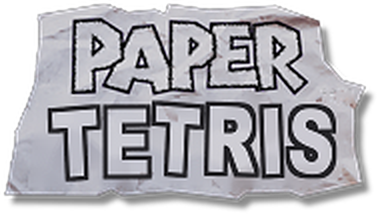
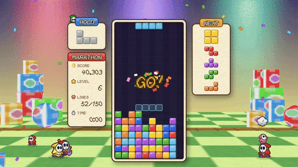
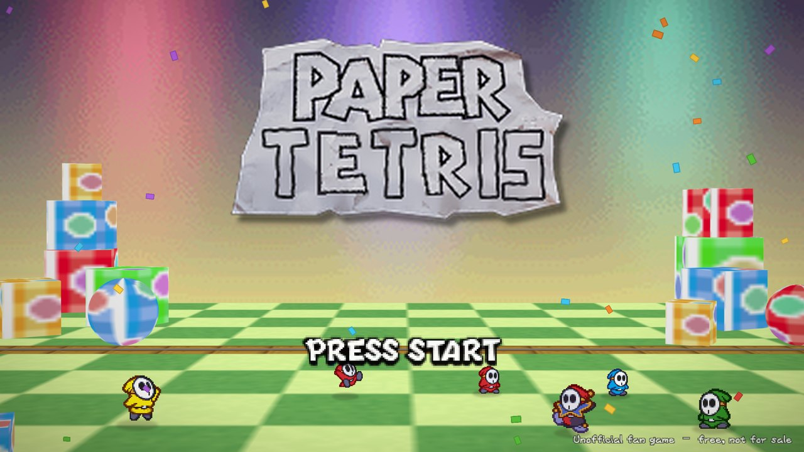
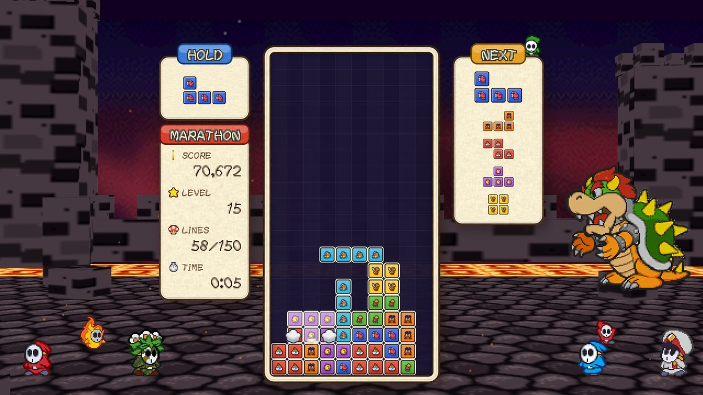
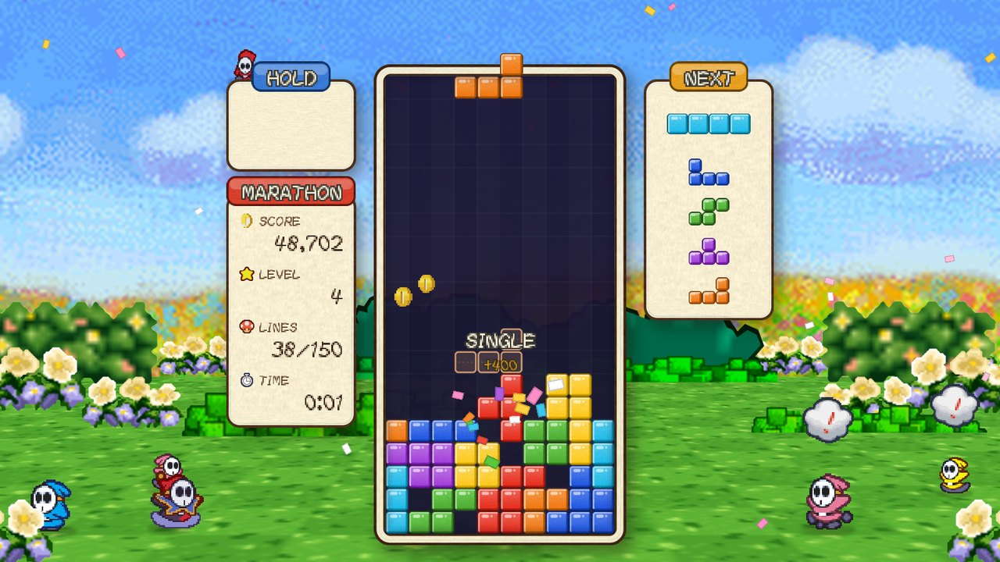
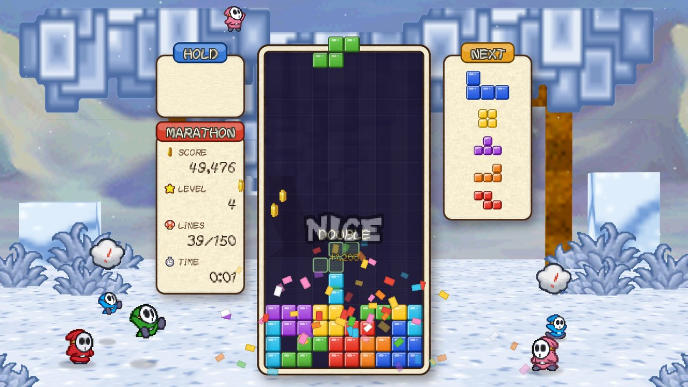
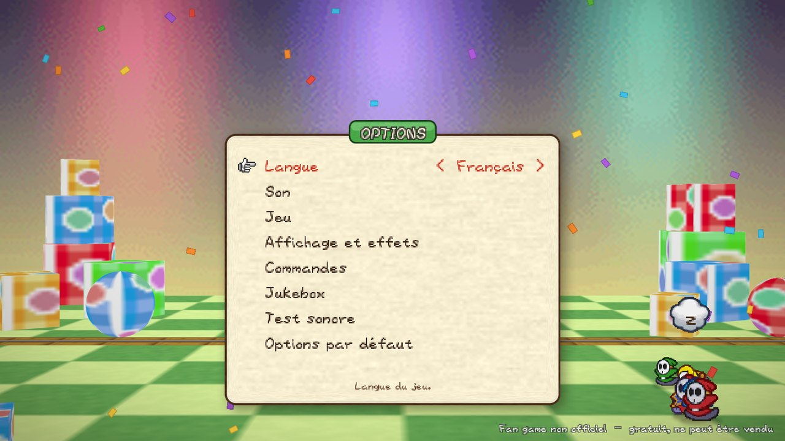
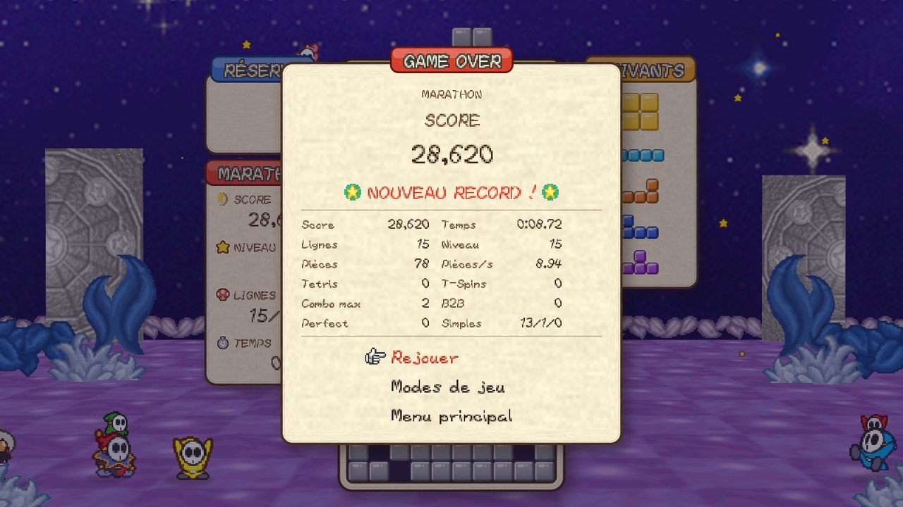
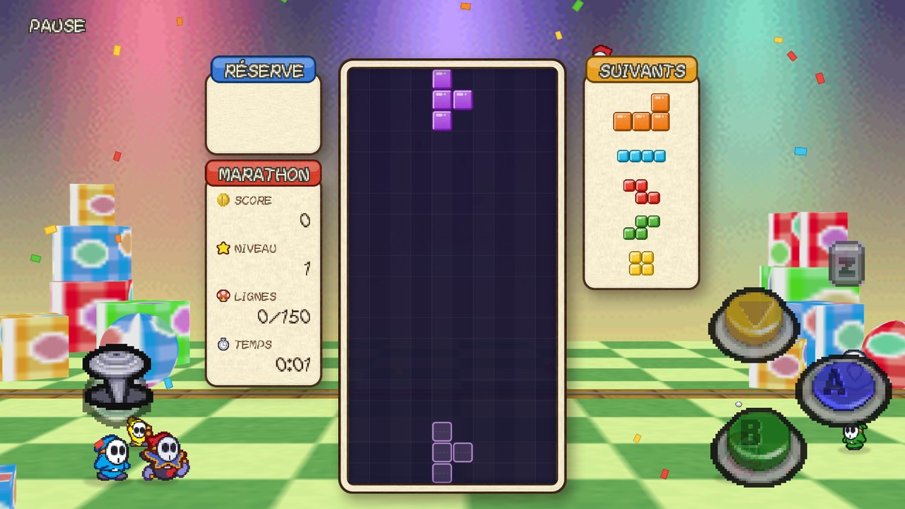

<p align="center">
  
</p>

<p align="center">
  <b>Classic Tetris, folded into a Paper Mario 64 storybook.</b><br>
  A free, unofficial fan game, starring the Shy Guy Toy Box troupe.
</p>

<p align="center">
  <a href="https://paper-tetris.holy-c.men/"><b>▶ Play in your browser</b></a>
  &nbsp;·&nbsp;
  <a href="https://github.com/BigFatDeuce/paper-tetris/releases/latest"><b>⬇ Download</b></a>
  &nbsp;·&nbsp;
  <a href="#-en-français">🇫🇷 En français</a>
</p>

<p align="center">
  
  
  
  
</p>

<p align="center">
  
</p>

---

## What is it?

**Paper Tetris** plays like the Tetris you know (no power-ups, no twists) and looks like a page of *Paper Mario* (N64, 2000). The board sits in the middle of real Paper Mario battle stages, rebuilt in 3D from the original models and textures. A troupe of Shy Guys hangs around the scenery: they dance when you score a Tetris, panic when the stack gets high, nap when you take your time, and fall flat when it's game over. They never touch the board. They're just here for the show.

<p align="center">
  
  
</p>

## Features

- **Strict modern Tetris:** SRS rotation with wall kicks, 7-bag randomizer, hold, ghost piece, up to 5 next pieces, lock delay with move reset, T-Spins (and minis), Back-to-Back, combos, Perfect Clears, adjustable DAS / ARR / soft drop speed.
- **5 modes:** Marathon (150 lines, 15 levels), Sprint 40 Lines, Ultra (3 minutes), Endless and Practice. Top-10 records are kept on your device.
- **9 Paper Mario stages:** Shy Guy's Toy Box, Pleasant Path, Flower Fields, Dry Dry Desert, Jade Jungle, Mt. Lavalava, Shiver Mountain, Shooting Star Summit and Bowser's Castle, where Bowser himself watches you play (and hates your Tetrises). In Marathon and Endless you travel from stage to stage as you level up, and Bowser's Castle is the last stop, from level 15 on.
- **Pieces with Mario's partners:** each piece is a paper tile with Sushie, Parakarry, Watt, Kooper, Lakilester, Bombette or Goombario, straight from the original sprites.
- **The Shy Guy troupe:** red, blue, green, pink, yellow and Anti Guys, with rare guest appearances from Groove Guy, Sky Guy, Spy Guy, Stilt Guy, Pyro Guy, Spear Guy, Traffic Guy and General Guy's parade.
- **Paper Mario juice:** NICE / GOOD / SUPER! words, the 100% burst on a Perfect Clear, coins flying into your score, dust clouds, spinning stars, hearts from the crowd and paper confetti everywhere.
- **The original soundtrack**: every stage alternates two themes from the same corner of the Mushroom Kingdom, with soft crossfades (Bowser's Castle opens with *Bowser, My Old Enemy!*); a jukebox picks your game music, and a sound test remixes every effect from the original samples.
- **Old-school list menus** that work with keyboard, mouse, gamepad and touch.
- **English and French**, switchable at any time in *Options*.
- **Comfort options:** screen shake Off / Light / Full, confetti on/off, crowd size from *None* to *Party*, or *Random* for a new troupe on every screen.

<p align="center">
  
  
  
  
</p>

## Play

### In your browser
Open **<https://paper-tetris.holy-c.men/>**. It works on desktop and on phones and tablets in landscape (on-screen controls appear by themselves). You can also install it as an app from your browser menu.

### Download
Grab the build for your system on the [latest release](https://github.com/BigFatDeuce/paper-tetris/releases/latest):

| System | File | Notes |
| --- | --- | --- |
| Windows 10/11 (64-bit) | `PaperTetris-…-windows.zip` | Unzip and run `PaperTetris.exe`. The game isn't code-signed, so SmartScreen may warn you: click *More info → Run anyway*. |
| Linux (x86_64) | `PaperTetris-…-linux.zip` | Unzip and run `PaperTetris.x86_64`. To add the game to your applications menu with its icon, run `sh install.sh` from the unzipped folder (`sh install.sh --uninstall` removes it). |
| macOS 11+ (Intel & Apple Silicon) | `PaperTetris-…-macos.zip` | Unzip and move *Paper Tetris* to Applications. The app isn't notarized: right-click it and choose *Open* the first time. |
| Android 7+ | `PaperTetris-…-android.apk` | Allow installs from your browser or file manager when Android asks, then open the APK. |

### Controls

| Action | Keyboard | Gamepad | Touch |
| --- | --- | --- | --- |
| Move | ← → / A D | D-Pad, left stick | Stick (left side) |
| Soft drop | ↓ / S | D-Pad ↓ | Stick down |
| Hard drop | Space / W | D-Pad ↑ | C▼ button |
| Rotate right | ↑ / X | A / Y | A button |
| Rotate left | Z / Ctrl | B / X | B button |
| Hold | C / Shift | LB / RB | Z button |
| Pause | Esc / P | Start | PAUSE |
| Fullscreen | F11 | Select / Back | — |

In menus: arrows or stick to move, Enter / Space / X / gamepad **A** to confirm, Esc / Z / Backspace / gamepad **B** to go back. Everything can be rebound in *Options → Controls*.

<p align="center">
  
</p>

## Building from source

The game is a [Godot 4.7](https://godotengine.org/) project (GDScript, *Compatibility* renderer) in [`game/`](game/).

1. Install **Godot 4.7.2** and its export templates.
2. Open `game/project.godot` in the editor and press **F5**, or run it from the command line:
   ```sh
   godot --path game
   ```
3. Run the tests (headless):
   ```sh
   sh tools/run_tests.sh
   ```
4. Build every platform into `dist/` (the script expects the Godot console executable in `tools/bin/godot/`; edit `G=` to point at yours):
   ```sh
   sh tools/export_all.sh            # or: web windows linux macos android
   ```
   The APK is signed with the key given in `GODOT_ANDROID_KEYSTORE_RELEASE_PATH` / `_USER` / `_PASSWORD`, and falls back to Godot's debug keystore.

The GIF above and the 45-second trailer are recorded in-engine with Godot's Movie Maker: `sh tools/record_trailer.sh <footage dir>` films every shot (a small showcase bot plays), renders the captions with the game's own paper windows and cuts everything with ffmpeg ([`tools/make_trailer.py`](tools/make_trailer.py)).

The ready-to-use game assets are in `game/assets/`. The Python scripts in [`tools/`](tools/) rebuild them (sprites, fonts, music, sound effects, the 3D-rendered stages and the icon) from the original ripped sheets, soundtrack and models. Those raw rips aren't part of this repository.

```
game/               Godot project
  src/core/         pure Tetris rules (engine, SRS, bag, modes), unit-tested
  src/game/         the match: board, HUD, juice, pause, results, touch controls
  src/actors/       the decorative Shy Guy troupe and its director
  src/stage/        PM64 dioramas, layered in front of and behind the board
  src/menu/         title, menus, records, options, credits
  src/autoload/     settings, saves, input, audio, languages, scene router
  data/             music, sound effects, characters, translations
  tests/            headless test suite and screenshot harness
tools/              asset pipelines (Python + a small Godot 3D renderer)
docs/               README images
```

## Credits

- **Produced by** BigFatDeuce, **design and programming** by Claude (Anthropic) with Claude Code.
- **Tetris** was created by Alexey Pajitnov (1984). Tetris is a trademark of The Tetris Company.
- **Paper Mario** (2000) was developed by Intelligent Systems and published by Nintendo. **Music:** Yuka Tsujiyoko and Taishi Senda.
- **Sprite rips** from [The Spriters Resource](https://www.spriters-resource.com/): Retriever II, Kimimaru, Oddball XP, Jackster.
- **Battle stage, area models and textures** from [The Models Resource](https://www.models-resource.com/): MasterGamePro, Alec Pike.
- **Sound samples** from [The Sounds Resource](https://www.sounds-resource.com/): aldelaro5.
- Made with the [Godot Engine](https://godotengine.org/).

## License

© 2026 BigFatDeuce. The code is free software under the [GPL-3.0-or-later](LICENSE): you can use, study, share and modify it, and versions you distribute must stay under the same licence.
The licence covers the game's own code only: the Nintendo and Intelligent Systems material described below is not covered and stays theirs.

## Legal

**Paper Tetris is an unofficial, non-commercial fan project.** It isn't affiliated with, endorsed, sponsored or approved by Nintendo, Intelligent Systems or The Tetris Company.

*Paper Mario*, the Shy Guys and every related character, name, sprite, model, texture, piece of music and sound effect used here are © **Nintendo** / **Intelligent Systems**. *Tetris* is a trademark of **The Tetris Company**. All rights belong to their respective owners, and this project claims no ownership over any of them. The game is given away for free. It must not be sold or bundled with anything sold.

If you are a rights holder and want something removed, please [open an issue](https://github.com/BigFatDeuce/paper-tetris/issues) and it will be taken down promptly.

---

## 🇫🇷 En français

**Paper Tetris** est un fan game gratuit et non officiel : un Tetris classique et strict (SRS, sac de 7, réserve, pièce fantôme, T-Spins, combos, Perfect Clear) habillé comme un livre d'images de *Paper Mario* sur N64. Les décors sont de vraies scènes de combat de Paper Mario, reconstruites en 3D à partir des modèles et textures d'origine. Une troupe de Maskass anime le décor : ils dansent sur un Tetris, paniquent quand la pile monte et s'effondrent au game over, sans jamais toucher au plateau.

- **Jouer dans le navigateur :** <https://paper-tetris.holy-c.men/> (PC, téléphone et tablette en paysage, avec commandes tactiles).
- **Télécharger** (Windows, Linux, macOS, Android) : [dernière version](https://github.com/BigFatDeuce/paper-tetris/releases/latest).
- **5 modes** (Marathon, Sprint 40 lignes, Ultra, Infini, Entraînement), **9 décors**, du coffre à jouets des Maskass jusqu'au château de Bowser, dernière étape du Marathon à partir du niveau 15, la bande originale de Paper Mario (deux thèmes par décor, enchaînés en fondu), des records sauvegardés sur l'appareil.
- **Les pièces portent les équipiers de Mario** (Sushie, Kooper volant, Watt, Kooper, Lakilester, Bombette, Goombario), tirés des sprites d'origine.
- **Français et anglais**, au choix dans *Options → Langue*. Plein écran avec **F11** ou **Select** sur la manette. Les secousses d'écran se règlent (Non / Légères / Fortes) dans *Options → Affichage et effets* ou dans le menu pause.
- Clavier, souris, manette (A valide, B revient) et écran tactile.

Paper Mario, les Maskass ainsi que tous les personnages, graphismes, musiques et sons associés appartiennent à **Nintendo** et **Intelligent Systems**. Tetris est une marque de **The Tetris Company**. Ce projet n'est ni affilié ni approuvé par eux. Il est gratuit et ne doit pas être vendu. Pour toute demande de retrait, [ouvrez une issue](https://github.com/BigFatDeuce/paper-tetris/issues).

© 2026 BigFatDeuce. Le code est un logiciel libre sous [GPL-3.0 ou ultérieure](LICENSE) : vous pouvez l'utiliser, l'étudier, le partager et le modifier, et les versions que vous distribuez restent sous la même licence. La licence couvre uniquement le code du jeu, pas les éléments de Nintendo et Intelligent Systems.
